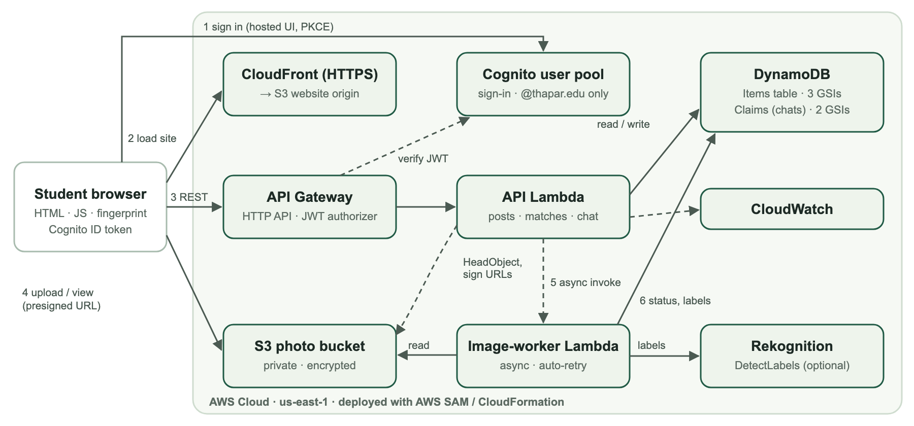

# UCS531 Cloud Computing — Project Proposal

| | |
|---|---|
| **1. Member** | Madhav Singla (individual project) |
| **2. Roll number** | 1024170356 |
| **3. Email** | opmadhav01@gmail.com |
| **4. Phone** | 7495071971 |
| **5. Lab** | L402, Monday, 3:30 pm |
| **6. Faculty advisor** | Ms. Ishani Rana |
| **7. Title** | **CampusFind: A Serverless Cloud-Based Campus Lost-and-Found System** |

## 8. Abstract and plan

**Problem.** On campus, lost and found items are reported in scattered WhatsApp groups, notice boards and help desks. Owners repeat descriptions in many places, finders do not know whom to tell, and phone numbers end up public.

**Solution.** CampusFind is one website for the whole campus. Students sign in with their college email, report what they lost or found (with a photo), get automatic match suggestions, and talk privately in a chat until the item is handed back. Moderators can remove fake or offensive posts.

**Objectives.**

1. Build a working web application deployed fully on the AWS cloud (no self-managed servers).
2. Store photos securely in cloud object storage and data in a managed NoSQL database.
3. Process photos in the background with an event-driven serverless function.
4. Suggest lost/found matches using photo, description, category and place.
5. Provide secure college-only sign-in and private two-person chat.
6. Define all infrastructure as code so it deploys with one command, and monitor it with CloudWatch.

**Cloud services.** Amazon CloudFront and S3 (website), Amazon Cognito (sign-in), API Gateway and AWS Lambda (application logic), Amazon DynamoDB (database), a private S3 bucket (photos), Amazon Rekognition (image labels), Amazon CloudWatch (monitoring), AWS CloudFormation / SAM (deployment).

{width=80%}

**Plan.** Week 1–2: requirements and architecture · Week 3–5: backend API, database and photo pipeline · Week 6–7: website pages, sign-in and chat · Week 8: deployment, testing and monitoring · Week 9: report, presentation and live demonstration.

**Deliverables.** Live website · source code on GitHub (https://github.com/Madhavvv1810/CampusFind) · project report · presentation and demo.
