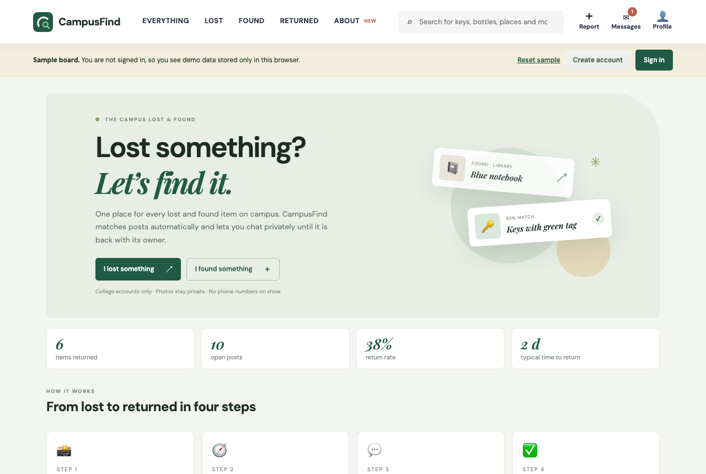
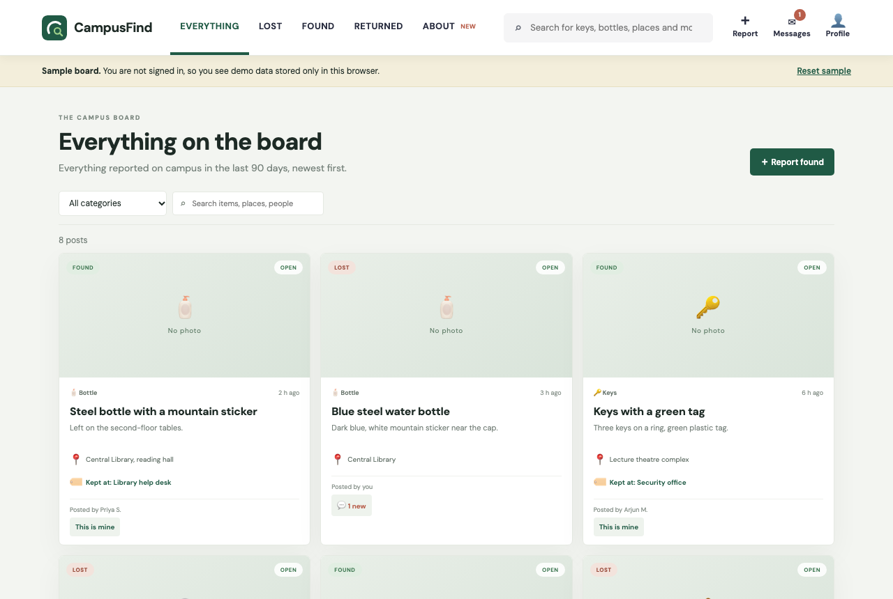
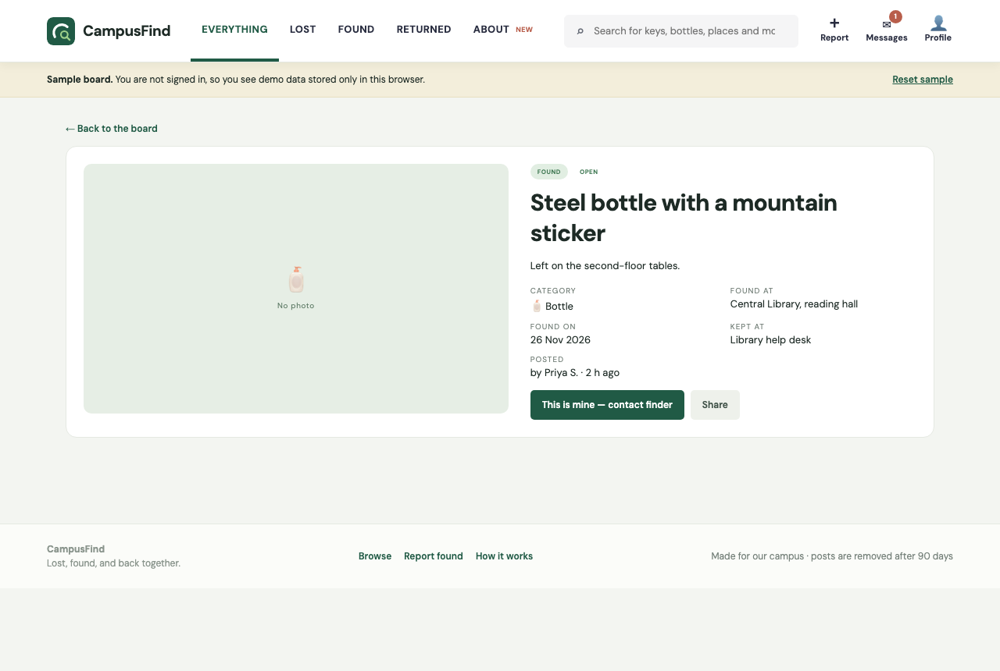
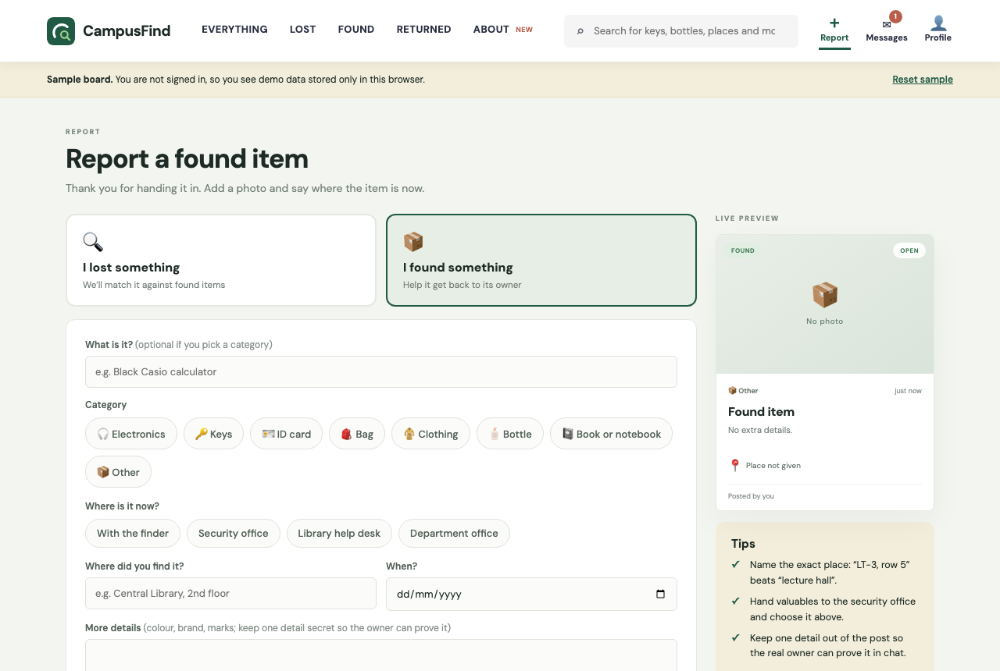
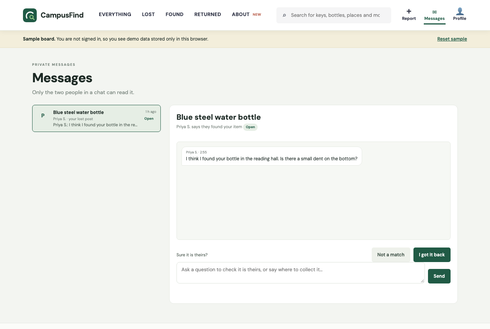
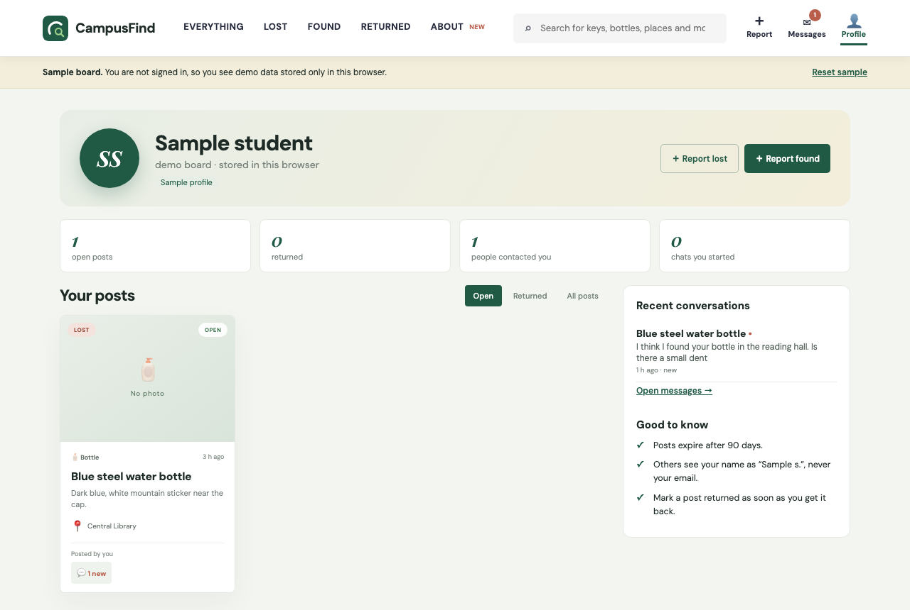
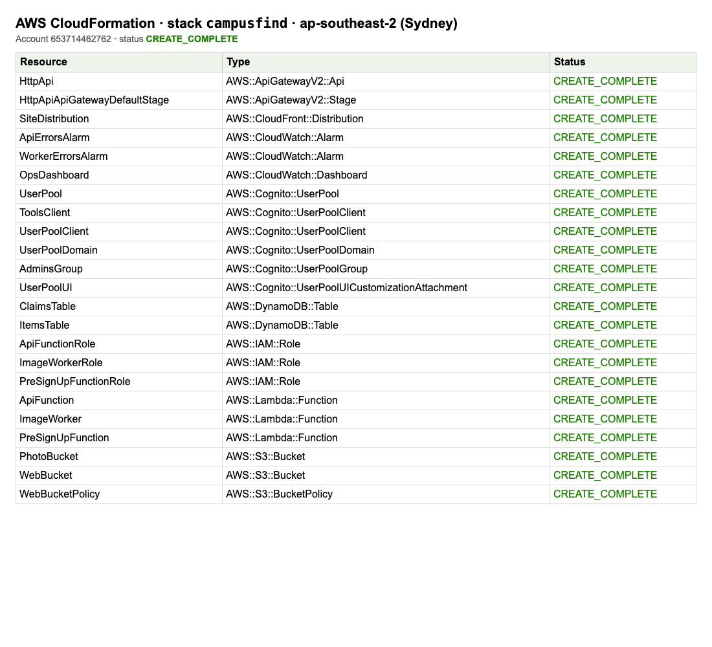

# CampusFind: A Serverless Cloud-Based Campus Lost-and-Found System

**UCS531 Cloud Computing · Project Report**\
**Madhav Singla · Roll No. 1024170356 · Lab L402 (Monday 3:30 pm) · Faculty advisor: Ms. Ishani Rana**\
**Live:** https://d10um63tuj87s.cloudfront.net · **Code:** https://github.com/Madhavvv1810/CampusFind

## 1. Problem statement

Lost and found items on campus are reported in scattered WhatsApp groups, notice boards and help desks. Owners repeat descriptions in many places, finders do not know whom to tell, and phone numbers end up public. There is no single, searchable and private place to reunite an item with its owner.

## 2. Objectives

1. Build a working web application deployed entirely on AWS, with no self-managed servers.
2. Store photos securely in cloud object storage and records in a managed NoSQL database.
3. Process photos in the background using event-driven serverless functions.
4. Suggest lost/found matches from photo, description, category and place.
5. Provide college-only sign-in, private two-person chat and moderation.
6. Deploy all infrastructure as code with one command, and monitor it with CloudWatch.

## 3. System architecture

| Service | Role in CampusFind |
|---|---|
| **CloudFront + S3** | Serves the website over HTTPS from edge locations |
| **Cognito** | Sign-up with email verification; only `@thapar.edu` emails allowed (pre-sign-up Lambda) |
| **API Gateway** | REST API; verifies the login token (JWT) on every request |
| **Lambda (3)** | API logic, background photo worker, sign-up check (Node.js 22) |
| **DynamoDB (2 tables)** | Posts and chats with indexes for the board, matches and inbox; posts expire after 90 days (TTL) |
| **S3 (private)** | Item photos, encrypted; uploaded and viewed through short-lived signed links |
| **Rekognition** | Image labels that improve matching |
| **CloudWatch** | Logs, operations dashboard and error alarms |
| **CloudFormation (SAM)** | The whole system defined in one template; one-command deploy and teardown |

**Flow (found item with a photo):** the student signs in through Cognito and fills in the report form. The browser shrinks the photo and removes its location data. API Gateway checks the token, and Lambda saves the post in DynamoDB and returns a temporary upload link. The photo goes straight to the private S3 bucket. A background Lambda labels the photo and publishes the post. When another student presses *"This is mine"*, a private chat opens; when the finder confirms, both posts close in one database transaction.

## 4. Implementation

- **Website (8 pages):** Home with live campus statistics, Browse (Everything / Lost / Found / Returned, categories, search), Report, Item page with suggested matches, Messages, Profile, Admin dashboard and About. The navigation bar works like a shopping site, and the layout works on phones.
- **Matching:** each post is scored against open posts of the opposite type: photo resemblance, shared words, category, place and image labels. The best matches are shown side by side.
- **Security and privacy:** college-only verified accounts; other students see only "First L."; private photos; server-side ownership checks; each Lambda has its own least-privilege IAM role; reported posts are hidden after three reports.
- **Quality:** 25 automated tests, a live end-to-end test script (8 checks on AWS) and GitHub Actions CI on every push.

## 5. Cloud deployment and demonstration

Deployed with `bash scripts/deploy.sh campusfind` to AWS **ap-southeast-2 (Sydney)** on a Free-plan account protected by a zero-spend budget alert. The stack contains 23 resources, all `CREATE_COMPLETE` (Fig. 7). **Demo:** sign up → report a found item with a photo → a second student finds it and presses "This is mine" → private chat → finder confirms the return → both posts show *Returned*.

**Challenges.** The AWS Academy lab first blocked databases, and the Sandbox allowed only one region, no new IAM roles and no Rekognition, while its sessions expire. CloudWatch logs pinpointed each problem. The final deployment uses a personal Free-plan account with proper per-function roles, so the link stays online permanently.

## 6. Working implementation screenshots

| | |
|---|---|
|  |  |
| **Fig. 1** Home page with live statistics | **Fig. 2** Browse: the campus board |
|  |  |
| **Fig. 3** Item page | **Fig. 4** Report a found item, with live preview |
|  |  |
| **Fig. 5** Private chat between finder and owner | **Fig. 6** Profile page |

**Fig. 7** AWS CloudFormation stack: all resources created successfully.

## 7. Conclusion and future work

CampusFind shows a complete, practical cloud application: serverless compute, managed storage and database, identity, a CDN, event-driven processing, monitoring and infrastructure as code, with no server to manage and almost no cost. Future work: instant notifications, email alerts, a custom domain and a mobile app.
