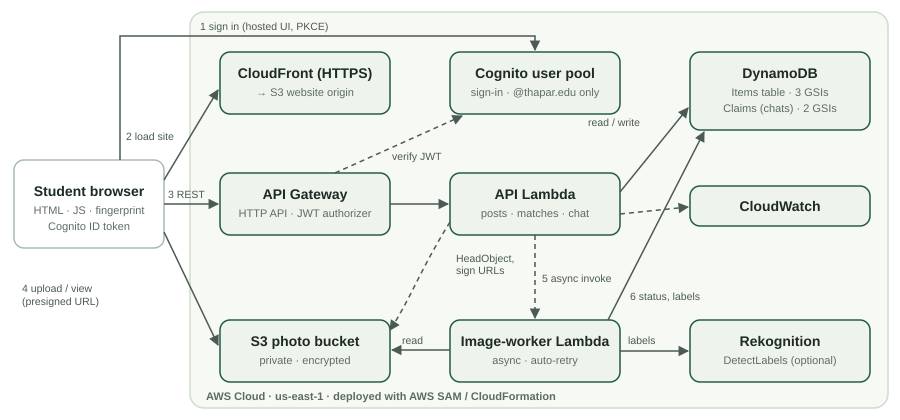

# CampusFind: An Event-Driven Cloud Lost-and-Found Matching System

**UCS531 — Cloud Computing · Project Report**\
**Madhav Singla · Roll No. 1024170356**

## 1. Introduction and problem

Lost-and-found information on campus is scattered across class chats, notice boards and help desks. A student who loses an item has to repeat its description in many places, and a student who finds one often does not know where to report it or how to reach the owner privately.

CampusFind is a shared, cloud-hosted campus board. Students sign in with their college email and post lost or found items with an optional photo. The cloud stores photos privately, analyses them asynchronously, ranks possible matches, and lets the finder and the owner talk in a private chat until the item is handed back.

## 2. Objectives and scope

1. Deploy a real serverless application on AWS, defined entirely as infrastructure-as-code (AWS SAM / CloudFormation).
2. Store photos in private object storage, uploaded directly from the browser through short-lived presigned URLs.
3. Process photos with an event-driven worker function, separate from the request path.
4. Rank lost/found matches using category, wording, location, an in-browser photo fingerprint and, where the account permits, Amazon Rekognition labels.
5. Provide private two-person messaging with an inbox and unread count, and record the handoff.
6. Restrict the service to verified college accounts and serve everything over HTTPS.
7. Keep the board trustworthy (reports, auto-hide, moderator dashboard) and observable (CloudWatch dashboard, alarms, structured logs).

**Scope:** one campus, `@thapar.edu` accounts, any phone photo (resized in the browser to ≤ 1600 px JPEG). Found posts require a photo; lost posts do not. The match score is a ranking aid, not proof of ownership; a person always decides.

## 3. Architecture

| Layer | AWS service | Role in CampusFind |
|---|---|---|
| Hosting | **CloudFront** → **S3** website | HTTPS, edge caching, managed security headers |
| Identity | **Amazon Cognito** user pool | Email-verified sign-up, hosted UI, OAuth 2.0 + PKCE; a pre-sign-up Lambda allows only `@thapar.edu` |
| API | **API Gateway** (HTTP API) | 16 REST routes behind a Cognito **JWT authorizer** (public: `GET /stats`); CORS restricted to the site |
| Compute | **AWS Lambda** — API function | Router + route modules: posts, matching, chat, reports, moderation, stats |
| Compute | **AWS Lambda** — image worker | Asynchronous photo analysis |
| Storage | **Amazon S3** (private bucket) | Photos; public access blocked, AES-256 encrypted |
| Database | **Amazon DynamoDB** (2 tables, 5 GSIs) | Posts, chats, inbox indexes; on-demand billing; TTL deletes records after 90 days |
| AI | **Amazon Rekognition** | `DetectLabels` on each photo (optional, see §6) |
| Operations | **CloudFormation / SAM**, **CloudWatch**, **GitHub Actions** | One-command deploy/teardown; ops dashboard (requests, errors, p95 latency, Lambda, DynamoDB), 2 alarms, JSON logs; CI on every push |

**Request flow for a found item with a photo:**

1. The browser resizes the photo to ≤ 1600 px JPEG (which also strips EXIF/GPS data), computes a 64-bit perceptual fingerprint, then calls `POST /items` with the student's Cognito ID token.
2. API Gateway verifies the token's signature, issuer and audience. The API Lambda takes the user ID and display name from the verified claims, validates the post, writes it to DynamoDB with status `AWAITING_UPLOAD`, and returns a 5-minute presigned S3 `PUT` URL.
3. The browser uploads the photo straight to the private bucket. No AWS credentials are ever in the browser.
4. `POST /items/{id}/complete` checks the object with `HeadObject` (size ≤ 5 MB), sets `PROCESSING`, and invokes the worker asynchronously (`InvocationType: Event`).
5. The worker calls Rekognition and saves the labels, setting the post to `ACTIVE`. Lambda retries the worker automatically on failure.
6. The board polls and shows the post once it is ready; photos are viewed through 10-minute presigned `GET` URLs.

## 4. Data model, matching and messaging

**Items table** (key `itemId`) stores type, title, category, location, date, where a found item is kept (security office, library desk…), owner, S3 key, fingerprint, labels, report count and status (`AWAITING_UPLOAD → PROCESSING → ACTIVE → RESOLVED`, or `HIDDEN` / `REMOVED`). Three global secondary indexes serve the campus board (`campusId, createdAt`), opposite-type candidates (`matchKey = "FOUND#keys"`), and a user's own posts.

**Matching:** `GET /items/{id}/matches` queries active posts of the opposite type in the same category and scores each one: 40 base + 20 same category + up to 30 for word overlap (Jaccard) + 5 per shared label (max 15) + 10 same location + up to 25 for photo-fingerprint similarity (Hamming distance). Results below 45 are dropped and the top 8 are shown with both photos side by side.

**Claims table** (key `itemId, claimId`) holds one private chat per person per post. Any student can press *This is mine — contact finder* on a found post (or *I found this — contact owner* on a lost post). Both people exchange messages (`list_append`, capped at 100). Two indexes, `OwnerIndex` and `ClaimantIndex` on `updatedAt`, power `GET /inbox`, which returns every conversation and an unread count from per-side "seen" timestamps. The owner closes a chat with *Not a match* or confirms *Returned it*; confirmation runs as a DynamoDB **transaction** that resolves the chat, the post and, if linked, the matching post atomically.

**Reports and moderation:** any student can report a post once (a DynamoDB string set of reporters with a `NOT contains` condition). Three reports set the post to `HIDDEN`; members of the Cognito `admins` group see a dashboard with a 14-day activity chart, category breakdown, return rate and median time to return, and can keep or remove reported posts.

## 5. Security

- **Private photos:** the photo bucket blocks all public access, encrypts at rest, and allows browser CORS only from the site's own origin. All access goes through presigned URLs that expire.
- **Ownership checks server-side:** only a post's owner can delete it, read its chats or confirm a handoff; only the two participants can read or write a chat.
- **Real authentication:** every route requires a Cognito-signed JWT, verified by API Gateway before Lambda runs. Sign-up requires a verified college email; the browser uses the OAuth 2.0 authorization-code flow with PKCE, so no client secret exists.
- **Minimal disclosure:** other students see only a first name and initial ("Madhav S."), never an email or user ID; responses carry a `mine` flag and chat keys are SHA-256 hashes.
- **HTTPS and headers:** CloudFront redirects HTTP to HTTPS and adds HSTS, `X-Frame-Options` and `X-Content-Type-Options` via the managed security-headers policy. Photo EXIF/GPS data is removed before upload.
- **Input validation** on every route (types, sizes, categories, date format, JSON body), plus HTML escaping in the browser.
- **Least exposure for tooling:** seed and smoke-test scripts sign in through a separate app client that accepts only `ADMIN_USER_PASSWORD_AUTH`, which requires AWS IAM credentials.
- **Trade-off:** tokens are kept in `localStorage` so students stay signed in; all user content is HTML-escaped to limit XSS risk.

## 6. Deployment and testing

The whole stack is one SAM template. `scripts/deploy.sh` builds, deploys, writes the API URL and Cognito settings into `config.js`, uploads the site and invalidates the CloudFront cache; `scripts/cleanup.sh` empties the buckets and deletes the stack.

**Deployed** to the AWS Academy Cloud Developing sandbox in `us-east-1`. The sandbox cannot create IAM roles, so all three functions run as the provided `LabRole`; the original least-privilege policies are kept in `docs/least-privilege-policies.yaml` for a normal account. The sandbox's `LabRole` also denies `rekognition:DetectLabels` (seen in CloudWatch as `AccessDeniedException`). The worker handles this case: it publishes the post with `labelSource: unavailable`, and matching uses the fingerprint, category, wording and location. On an account with Rekognition access, labels are added with no code change.

**Testing:**

- **Design for testing:** routes receive their DynamoDB store, S3 and Lambda adapters as injected dependencies, so 25 `node:test` cases run against an in-memory store that applies the same conditions: validation, matching, stats, the update-expression builder, the worker's fallback, and full journeys (post → upload → match → chat → handoff, reports → auto-hide → moderation, paging, privacy of every response).
- **Live smoke test** (`scripts/smoke-test.mjs`, 8 checks, about 25 s): two temporary Cognito users post, match, chat and complete a handoff through the real API, S3 and image worker, then are deleted.
- **Continuous integration:** GitHub Actions runs the tests, checks that the browser's copy of the matching code is identical to the API's, syntax-checks every module and validates the template.
- Live checks on the deployed stack: HTTP redirects to HTTPS (301) with HSTS and frame/sniff headers; API returns 401 with no token or a forged token; CORS allows only the CloudFront origin; the hosted sign-up page opens with PKCE; a `@gmail.com` sign-up is rejected by the pre-sign-up Lambda while `@thapar.edu` is accepted.
- **Sample data:** `scripts/seed.mjs` adds eight sample students, 16 posts with photos, five chats and completed handoffs through the real API, spread over two weeks; sample posts are labelled "Sample" and `--clean` removes them.
- Browser demo mode (no AWS) was exercised on desktop and a 375 px phone viewport.

## 7. Syllabus mapping, limitations and future work

| UCS531 topic | Where it appears |
|---|---|
| Cloud service models (IaaS/PaaS/FaaS) | Lambda (FaaS), managed S3/DynamoDB/API Gateway |
| Virtualisation and serverless compute | Lambda functions, on-demand scaling |
| Cloud storage and CDN | S3 private objects, presigned URLs, CloudFront edge caching |
| NoSQL databases | DynamoDB partition/sort keys, GSIs, transactions |
| Event-driven architecture | Asynchronous Lambda invocation with retries |
| Infrastructure as code / DevOps | SAM / CloudFormation, deploy and cleanup scripts, GitHub Actions CI |
| Cloud security and identity | Cognito, JWT authorizer, private buckets, encryption, IAM roles, CORS |
| Monitoring | CloudWatch dashboard, alarms, structured JSON logs; logs used to diagnose the Rekognition permission issue |

**Limitations:** chat polls instead of pushing, generic image labels (and none in the sandbox), no email notifications (SES is not available in the sandbox).\
**Future work:** WebSocket (API Gateway) push notifications, SES email alerts, image moderation with Rekognition `DetectModerationLabels`, a custom domain on CloudFront.
