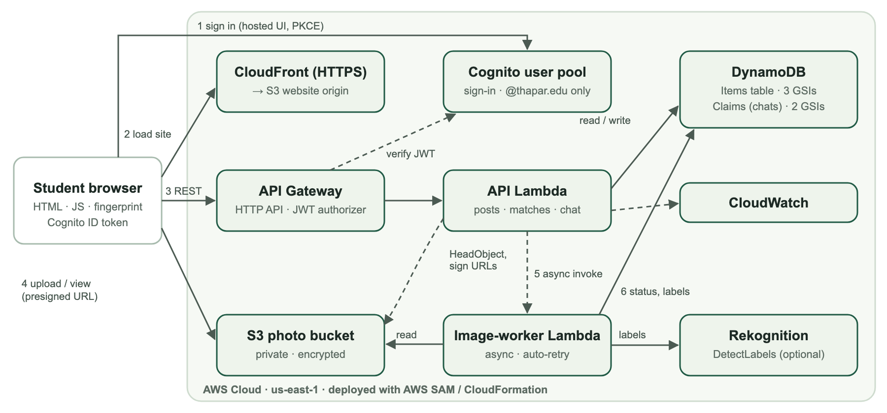

# CampusFind

[](../../actions/workflows/ci.yml)

**CampusFind** is a serverless lost-and-found service for a college campus, built on AWS. Students sign in with their college email, post what they lost or found, get ranked match suggestions, and talk to the finder or owner in a private chat until the item is handed back. Moderators review reported posts from an admin dashboard.

**Live:** https://d10um63tuj87s.cloudfront.net · **Ops dashboard:** CloudWatch `campusfind-ops`



## Features

| For students | For moderators and operators |
|---|---|
| College-only sign-up (`@thapar.edu`, email-verified, Cognito) | Admin dashboard: 14-day activity chart, category breakdown, return rate, median time to return |
| Lost/found posts with photo, place suggestions, date and *where it is kept* (security office, library desk…) | Reported-post queue: keep or remove; 3 reports auto-hide a post |
| Photos resized in the browser, GPS/EXIF stripped, uploaded straight to private S3 | CloudWatch dashboard (requests, errors, p95 latency, Lambda, DynamoDB) and two alarms |
| Ranked matches: photo fingerprint, wording, category, place, image labels | Structured JSON logs, queryable with Logs Insights |
| Item pages with shareable links (`#item=<id>`) | Live smoke test and seed scripts |
| *This is mine* / *I found this* private chat, Messages inbox with unread badge | 90-day automatic expiry (DynamoDB TTL) |
| Owner tools: edit, mark returned, delete, retry photo | One-command deploy and teardown |
| Report a post; installable on a phone (web app manifest) | GitHub Actions CI |

Pages: **Home** (live stats, how it works, recently found) · **Browse** (filters, categories, search) · **Report** (lost/found form with photo preview) · **Item** (details, owner tools, inline matches, share, report) · **Messages** (two-pane inbox and chat) · **My posts** · **Admin** · **About**. The header works like a shopping site: uppercase sections, a category menu on hover, a search bar and Report / Messages / Profile buttons.

Signed-out visitors see real campus stats and a sample board that lives only in their browser.

## Architecture

| Layer | Service | Notes |
|---|---|---|
| Web | CloudFront → S3 website | HTTPS, managed security headers, cache invalidated on deploy |
| Identity | Cognito user pool, hosted UI, `admins` group | OAuth 2.0 code flow + PKCE; pre-sign-up Lambda enforces the college domain |
| API | API Gateway HTTP API, 16 routes | Cognito JWT authorizer on all routes except public `GET /stats` |
| Compute | Lambda (Node.js 22, arm64) × 3 | REST API, image worker (async, retried), pre-sign-up trigger |
| Data | DynamoDB: Items (3 GSIs), Claims (2 GSIs), TTL | Board, match candidates, owner posts, inbox by owner and by sender |
| Files | S3 private bucket | Presigned PUT (5 min) / GET (10 min), AES-256, public access blocked |
| AI | Rekognition `DetectLabels` | Optional; posts still publish if the account denies it |
| Ops | CloudFormation (SAM), CloudWatch dashboard + alarms, GitHub Actions | |

## Code layout

```
web/                         Static front end (no build step, ES modules)
  js/main.js                 Boot: choose backend, register routes, polling
  js/router.js               History-API router (clean URLs; CloudFront serves index.html for any path)
  js/pages/                  home, browse, report, item, mine, about (+ chat.js Messages, admin.js Admin)
  js/backend-cloud.js        REST client (API Gateway + Cognito token)
  js/backend-demo.js         Same interface, in-browser sample data
  js/components.js           Shared cards, tags, stats tiles
  js/auth.js, photos.js, state.js, util.js
  js/matching.js             Byte-identical copy of backend/src/matching.js (checked in CI)
backend/
  src/app.js                 Router: route table, auth gate, errors, JSON logs
  src/routes/                items.js, claims.js, admin.js
  src/validation.js, matching.js, stats.js, views.js, identity.js, http.js
  src/aws/                   DynamoDB store, S3 files, Lambda analyzer (thin adapters)
  src/index.js, analyze.js, presignup.js   Lambda entry points
  test/                      node:test suites against an in-memory store
scripts/                     deploy.sh, cleanup.sh, seed.mjs, smoke-test.mjs
template.yaml                All infrastructure (AWS SAM)
```

Routes depend on an injected `store`, `files` and `analyzer`, so the same code runs on AWS and in tests. Browser views talk to one `backend` interface with two implementations (cloud and demo), so no view branches on mode.

## Develop and test

```sh
cd backend && npm ci && npm test        # 25 unit + API tests, no AWS needed
node scripts/dev-server.mjs              # http://localhost:8123 with the same route fallback as CloudFront
```

Live checks against a deployed stack (creates and deletes two temporary users):

```sh
AWS_REGION=us-east-1 node scripts/smoke-test.mjs
```

## Deploy

Requirements: AWS CLI v2, AWS SAM CLI, Node.js 22.

```sh
AWS_REGION=us-east-1 bash scripts/deploy.sh campusfind     # ~10 min first time (CloudFront)
AWS_REGION=us-east-1 node scripts/seed.mjs                 # optional sample activity (--clean removes it)
aws cognito-idp admin-add-user-to-group --user-pool-id <UserPoolId> --username <your email> --group-name admins
```

- Allow any email domain: `ALLOWED_EMAIL_DOMAIN= bash scripts/deploy.sh campusfind`.
- **AWS Academy:** use the Cloud Developing course **Sandbox** in `us-east-1`. It cannot create IAM roles, so all functions run as the lab's `LabRole`; scoped per-function policies for a normal account are in `docs/least-privilege-policies.yaml`.
- Tear down everything: `AWS_REGION=us-east-1 bash scripts/cleanup.sh campusfind`.

## API

All routes need `Authorization: Bearer <Cognito ID token>` except `GET /stats`.

| Route | Purpose |
|---|---|
| `GET /stats` | Public campus numbers (cached 60 s) |
| `GET /items?cursor=` | Board, newest first, 60 per page |
| `POST /items` | Create a post; returns a presigned upload URL when a photo is attached |
| `GET /items/{id}` | One post |
| `PATCH /items/{id}` | Owner edits fields, or `{status:'RESOLVED'}` |
| `DELETE /items/{id}` | Owner or moderator removes the post and its photo |
| `POST /items/{id}/complete` | Confirm the upload, queue photo analysis |
| `GET /items/{id}/matches` | Ranked opposite-type suggestions |
| `POST /items/{id}/report` | Report once per student; 3 reports hide the post |
| `GET /items/{id}/claims` | Owner: all chats about the post; others: their own |
| `POST /items/{id}/claims` | Start a private chat |
| `POST /items/{id}/claims/{claimId}/messages` | Send a message |
| `PATCH /items/{id}/claims/{claimId}` | `{seen:true}`, or owner `{status:'ACCEPTED'\|'DECLINED', reply}` (accept is a DynamoDB transaction) |
| `GET /inbox` | All your chats with unread count |
| `GET /admin/overview` | Moderators: stats and reported posts |
| `POST /admin/items/{id}/moderate` | Moderators: `{action:'restore'\|'remove'}` |

## Security

- Identity comes only from the Cognito-signed JWT, verified by API Gateway before Lambda runs. User IDs, emails, photo fingerprints and reporter lists never leave the API; responses carry `mine` / `role` flags and show names as "Madhav S.".
- Ownership, chat membership and moderator rights are checked server-side on every route; every input is validated in the API and escaped in the browser.
- The tools app client accepts only `ADMIN_USER_PASSWORD_AUTH`, which needs AWS IAM credentials, so it cannot be used from a browser.
- Trade-offs: tokens live in `localStorage` so students stay signed in; chats poll every few seconds instead of using WebSockets.

## UCS531 syllabus mapping

| Topic | CampusFind |
|---|---|
| Service models | FaaS (Lambda) on managed services (S3, DynamoDB, API Gateway, Cognito, CloudFront) |
| Storage and CDN | S3 private objects, presigned URLs, CloudFront edge caching |
| NoSQL | DynamoDB keys, 5 GSIs, conditional writes, transactions, TTL |
| Event-driven computing | Async Lambda invocation with retries; Cognito triggers |
| Security and identity | Cognito + JWT authorizer, groups, encryption, CORS, IAM roles |
| DevOps / IaC | SAM / CloudFormation, CI, smoke tests, seed data |
| Monitoring | CloudWatch dashboard, alarms, structured logs |
